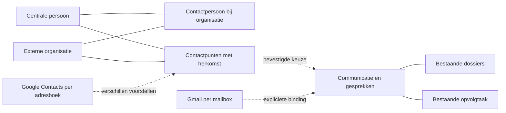

# Pakket 13 — gezamenlijk ontwerp voor contacten, communicatie en opvolging

Aanvulling: zie de [gezamenlijke lokale bouw van pakketten 13–15](Contacten-en-communicatie-pakketten-13-15.md) voor de geïmplementeerde eerste versie, afwijkende interne tabelnamen, concrete begrenzingen en open echte proeven. Onderstaand ontwerp blijft het voorafgaande voorstel; het verleent geen live uitvoeringsakkoord.

15 november 2026. **Voorgesteld ontwerp**, lokaal uitgewerkt op basis van de [inventaris](Pakket-13-inventaris.md). Geen schema, scherm, bevoegdheid of integratie is hiermee geïmplementeerd of geactiveerd. De [acceptatievolgorde](Pakket-13-uitvoering-en-acceptatie.md) scheidt ontwerp, lokale bouw en later toegestane live handelingen.

## 1. Het gewenste gebruik

Een beheerder opent één contactfiche, ziet bij welke organisaties iemand betrokken is, kiest het juiste adres, opent de toegestane communicatie en maakt een opvolgtaak. Een binnenkomende mail levert eerst een voorstel op voor persoon en dossier. Een naam of e-mailadres veroorzaakt geen automatische samenvoeging, accounttoegang, nieuwsbriefinschrijving of nieuwe taak.

De bestaande routes blijven bruikbaar. Er komt geen tweede CRM met een eigen personenregister. De gebruikersnamen en navigatiewijzigingen hieronder zijn voorstellen:

- **Contacten:** zoeken in bestaande personen en externe organisaties, met herkenbare aparte resultaten. Een ontbrekende e-mail is 'Niet ingevuld', geen uitnodiging of foutieve placeholder.
- **Persoonsfiche:** Overzicht, Organisaties & functies, Contactgegevens, Communicatie, Opvolging, Documenten; Account & toegang behoudt zijn afzonderlijke beheergrens.
- **Organisatiefiche:** bestaande contacten en contactmomenten behouden; Communicatie en Opvolging tonen dezelfde gekoppelde objecten als de persoonsfiche.
- **Communicatie:** concepten, ter beoordeling, gesprekken en opvolging. Een gesprek heeft status 'Nog niet gekoppeld' of 'Meerdere kandidaten' zolang de binding niet bevestigd is.
- **Koppelingen beheren:** mailbox-/adresboekbinding, laatste geslaagde controle, voorgestelde verschillen, conflicten en gepauzeerde verwerking; geen knop die lezen en schrijven in één onzichtbare actie combineert.

Een verbonden mailbox verleent een gebruiker geen leesrecht op alle communicatie. Het feit dat een mail bij een openbaar of breed leesbaar dossier hoort, maakt de mailinhoud niet openbaar.

## 2. Eigenaarschap van gegevens

| Gegevens | Voorgestelde leidende bron | Regel |
| --- | --- | --- |
| Persoon, organisatie, functies, dossierverbanden, interne notities en opvolging | Command Center | Behoud bestaande IDs en historie; Google geeft geen rollen of formele CRM-status |
| Auth-account, organisatie-/portaalrechten | Bestaand BESC-toegangsbeheer | Nooit vanuit Google Contacts, afzenderadres of CRM-contactrol toekennen |
| E-mailinhoud, Gmail message/thread/draft-ID en feitelijke mailboxstatus | Gmail | Command Center bewaart gecontroleerde kopie/metadata en binding; lokale status is geen zelfstandig verzendbewijs |
| Opgesteld concept, gekozen ontvangers, goedkeuringsronde en verzendbesluit | Command Center | Goedkeuring hoort bij een onveranderlijke inhoudsversie; Gmail-wijziging blokkeert verzending totdat de nieuwe inhoud is beoordeeld |
| Google-contactresource en diens bronversie/etag | Geselecteerd Google-adresboek | Alleen de expliciet gekoppelde CONTACT-bron behandelen; geen automatische omzetting naar een BESC-account |
| Naam, e-mail, telefoon, functie uit Google Contacts | Voorgesteld verschil | Eerst vergelijken met lokale waarde en laatst bevestigde basis; toepassingsrichting per veld en rij tonen |
| Interne beoordelingen, contracten, notities, rollen, taakdetails, Bcc en mailinhoud | Alleen binnen hun bestaande bevoegde omgeving | Niet exporteren naar Google Contacts; geen algemene veldspiegel |

Voorstel voor de eerste Contacts-versie: handmatig starten, alleen lezen naar een afgeschermde vergelijklijst en daarna afzonderlijk gekozen wijzigingen lokaal toepassen. Een bestaande CC-waarde wordt niet automatisch door Google vervangen. Terugschrijven naar Google en automatische tweerichtingssynchronisatie zijn aparte latere besluiten. Dit voorstel is nog geen toestemming om gegevens te lezen of te wijzigen.

## 3. Conceptueel gegevensmodel

Alle nieuwe namen in deze tabel zijn **ontwerpnamen**. Er is geen SQL gegenereerd. Bij implementatie eerst bestaande constraints en beleid toetsen; elke nieuwe tabel krijgt tenantbinding, passende databasebeveiliging en beperkte serverpoorten.

| Object | Hergebruik / voorgestelde uitbreiding | Identiteit en grens |
| --- | --- | --- |
| Persoon | `community_people` behouden | Bestaand ID en BESC-organization-ID; `account_user_id` niet door integratie schrijven |
| Externe organisatie | `partners` behouden | Geen nieuwe `public.organizations`-tenant voor een klant/sponsor |
| Organisatierelatie | `partner_contacts` behouden | Functie/primair aanspreekpunt blijven relatiegebonden. Zelfstandige oude contacten mogen ongekoppeld blijven tot bewuste koppeling |
| Contactpunt | Voorgestelde `crm_person_contact_points` / `crm_partner_contact_points` | E-mail/telefoon, label, originele waarde, zoeksleutel, herkomst, verificatiestatus en actief/vanaf-tot. Precies één eigenaar; aparte persoons- en organisatiebinding voorkomt een gedeelde info-mailbox als fictieve persoon |
| Mailbox/adresboek | Voorgestelde `crm_google_connections` | Eén expliciete tenant, provideraccountidentiteit en capabilityset. Credential alleen in beveiligde serveropslag; geen gedeeld token in browser of ontwerpbestanden |
| Externe contactbinding | Voorgestelde `crm_google_contact_links` | Uniek op tenant + verbinding + Google resourceName + CONTACT source-ID; koppelt naar één centrale persoon of één organisatie, inclusief bron-etag en laatst bevestigde veldbasis |
| Gesprek | Voorgestelde `crm_mail_threads` | Uniek op tenant + mailboxbinding + Gmail thread-ID; geen globaal thread-ID of onderwerp als sleutel |
| Bericht | Voorgestelde `crm_mail_messages` | Uniek op tenant + mailboxbinding + Gmail message-ID; immutable ontvangstversie, richting, deelnemerssnapshot, beperkte veilige inhoud en providerstatus |
| Personen/dossiers bij gesprek | Voorgestelde expliciete join-objecten | Meerdere gekoppelde personen/dossiers mogelijk, steeds binnen dezelfde tenant; eigen rechten per koppeling en zichtbaarheid, geen generiek ongecontroleerd entity-ID |
| Bestaande mailfiche | `email_communications` behouden | Primaire dossierkoppeling en oude IDs/goedkeuringen blijven; nieuwe verwijzing naar mailbox/gesprek/bericht en inhoudsversie alleen via gerichte latere migratie |
| Verzendopdracht | Voorgestelde `crm_mail_outbox` + gebeurtenissen/ontvangstbewijzen | Eén job per goedgekeurde inhoudsversie, duurzame exclusieve claim, geen tweede muterende poging na onbekende externe uitkomst |
| Vergelijk-/syncronde | Voorgestelde `crm_google_sync_runs`, voorstellen en gebeurtenissen | Vast verbinding-ID, parameters, doel, revisie en cursor; opgeslagen ontvangst en cursorwijziging atomair. Voorstel is geen wijziging |
| Opvolging | Bestaande `tasks` en `partner_interactions` | Nieuwe expliciete bronverwijzing voorkomt dubbele taak/contactmomenten. Ontvangst van een mail zet niet vanzelf eigenaar, deadline of formele status |

Migratiepad: eerst alleen aanvullende tabellen/optionele bindingsvelden. Toon en beoordeel verouderde kopieën; geen automatische backfill, merge of verwijdering. Bestaande centrale persoon blijft leidend voor de al gekoppelde persoonsidentiteit; een organisatieadres of relatiegebonden adres mag daarnaast geldig blijven. Welke waarde voor verzending gekozen is, komt als snapshot in het concept. Latere profielwijzigingen veranderen geen oude verzendhistorie.

## 4. Zoeken, koppelen en dubbele contacten

1. Zoek eerst op een bevestigde binding binnen dezelfde tenant en verbinding. Een onverwachte meervoudige binding blokkeert de rij.
2. Een exact overeenkomend adres levert een **kandidaat** op, geen bewezen identiteit. Gedeelde mailboxen en hergebruikte adressen blijven mogelijk. Bij twee kandidaten eerst handmatig beslissen.
3. Een naam, domein, telefoon of onderwerp alleen koppelt niets. Telefoonnummers pas normaliseren met bekende landcontext; anders originele waarde behouden. Voor e-mail alleen veilige vergelijking: witruimte rondom weg, domein normaliseren; geen punten of `+tag` verwijderen, geen lokale hoofdlettervariant als identiteitsbewijs gebruiken.
4. Google-identiteit, BESC-account en contactadres blijven verschillende zaken. Een geïmporteerd adres is niet 'geverifieerd' omdat het uit Google komt. Bij nul kandidaten: voorstel om nieuw contact te maken, zonder account/rollen/toegang.
5. Bevestig per veld 'bestaande behouden', 'voorgestelde overnemen', 'extra contactpunt toevoegen' of 'overslaan'. Bewaar herkomst en degene die beslist; bulkgoedkeuring toont dezelfde concrete rijen en aantallen.
6. Er komt in de eerste versie geen samenvoegknop. Een latere merge moet dossierverbanden, historie, rollen, Bucks en accounts afzonderlijk inventariseren. Afwijzing wordt bewaard om dezelfde ongewenste match niet telkens opnieuw voor te stellen.

## 5. Gmail: gesprekken, beoordelen en veilig verzenden

Gmail kan al concepten bewaren en versturen vanuit de bestaande code. Het vervolg bouwt hierop verder; het vervangt geen nieuwsbrieven of event-slotproces.

**Ontvangen:** alleen een later gekozen organisatie-mailbox, selectie en periode. Message-ID bepaalt ontvangstidentiteit; thread-ID groepeert uitsluitend binnen die mailbox. Eerst beperkte metadata, pas na de daarvoor afgesproken scope en rechten ook inhoud. Een adresmatch stelt een contact voor. Een onderwerp matcht geen dossier automatisch. Een gesprek over meerdere dossiers vraagt een expliciete koppeling; koppelen mag de bestaande mailtoegang niet verruimen. Verwijderen van een Gmail-bericht meldt een bronwijziging en wist geen CRM-dossier of historie.

**Opstellen/antwoorden:** kies centrale persoon/organisatie en exact contactpunt. Toon From, To, Cc, Bcc, onderwerp, tekst, eventueel gesaneerde HTML en primaire dossierbinding vóór beoordeling. Voor een antwoord zijn zowel Gmail thread-ID als correcte `In-Reply-To`/`References` en passend onderwerp nodig; het huidige opslaan van een thread-ID achteraf levert die functie nog niet. 'Allen antwoorden' krijgt een nieuwe ontvangerkeuze; Bcc wordt niet als gewone gesprekdeelnemer aan andere gebruikers getoond.

**Goedkeuren:** maak een nieuwe expliciete snapshot met inhoudshash, mailboxbinding, From/To/Cc/Bcc, onderwerp, bodies, eventuele bijlagehashes en replycontext. Respecteer bestaande aparte beoordelaar. Wijziging van inhoud, ontvangers, doelmailbox of relevante bron vraagt nieuwe beoordeling. Oude goedkeuringen blijven historische records en worden niet achteraf als nieuwe versie aangemerkt.

**Verzenden:** autorisatie en actuele sessie controleren; exclusieve claim vóór muterende provideractie. Lees het actuele Gmail-concept en vergelijk met de goedgekeurde versie. Een onleesbaar of buiten CC gewijzigd concept blokkeert verzending. Bewaar het resultaat van een conceptwijziging voordat verzending kan beginnen. De laatste Gmail-controle kan een gelijktijdige externe Gmail-editor niet atomair uitsluiten: blokkeer/waarschuw parallelle bewerking en onderzoek in pakket 14 verzending van exact de goedgekeurde MIME-snapshot. Google garandeert hiermee geen precies-één-verzending.

Voorgestelde outboxstatussen: `prepared → claimed → dispatched → confirmed`; daarnaast `blocked_before_dispatch`, `failed_before_dispatch`, `uncertain` en `cancelled_before_claim`. Na een time-out of verloren antwoord na dispatch geen automatische nieuwe send. Alleen-lezen bewijs zoeken binnen dezelfde job/mailbox; een ontbrekend zoekresultaat is geen bewijs dat er niets verstuurd is. Een eigen RFC Message-ID kan correlatie helpen, maar is geen provider-idempotentiesleutel. Een herstart mag een onzekere mutatie niet opnieuw versturen.

Providerantwoord, lokale verzendregistratie, gebeurtenis en vervolgtaak krijgen duurzame idempotente verwerking. Eerst de provideruitkomst vastleggen, daarna lokale vervolgacties herhalen met een unieke bronjob; een mislukte vervolgtaak mag de mail niet nogmaals sturen. 'Verzonden' betekent door Gmail bevestigd, niet gelezen of afgeleverd bij de ontvanger.

## 6. Google Contacts: richting, conflicten en hervatten

De People API levert contacten van de aangemelde gebruiker. Dat is geen automatisch gedeeld Workspace-adresboek en ook geen koppeling naar iedere BESC-gebruiker. Eén organisatie-adresboekhouder en bereik worden vóór bouwacceptatie expliciet gekozen. Persoonlijke adresboeken, Directory en Other Contacts blijven buiten de eerste versie.

Lees alleen de CONTACT-bron en minimaal noodzakelijke velden (voorstel: metadata, namen, e-mailadressen, telefoons en organisaties). Extra velden, zoals verjaardagen, foto’s en notities, blijven uit. Bewaar originele multivaluewaarden; de bestaande enkelvoudige `email` mag andere adressen niet vernietigen.

Vergelijk per veld drie waarden: laatst bevestigde basis, huidige CC-waarde en huidige Google-waarde. Alleen Google gewijzigd: voorstel; alleen CC gewijzigd: lokaal behouden, geen stil terugschrijven; beide verschillend gewijzigd: conflict. Gelijk gewijzigde waarden kunnen als 'geen inhoudelijk verschil' worden geregistreerd zonder identiteit of verificatiestatus op te waarderen. Leegte wist geen bestaand veld zonder expliciete beslissing. Bronverwijdering maakt een tombstone/opvolgpunt, geen cascadeverwijdering in CC.

Een leesronde heeft onveranderlijke selectie/fieldmask, binding en revisie. Bewaar iedere gevalideerde pagina en voortgang atomair; verloren opslagantwoord eerst teruglezen. Commit het nieuwe sync-token alleen na de laatste volledig bevestigde pagina. Afgebroken of deels ongeldige pagina's schuiven de cursor niet door. Bij accountwissel of gewijzigde parameters geen cursor hergebruiken.

Bij verlopen Contacts-sync-token nieuwe begrensde inventaris voorbereiden met behoud van bestaande bindingen; niet alles wissen of zonder toestemming breder importeren. Bij een etagconflict vóór een eventuele latere Google-write: opnieuw lezen en nieuw voorstel, niet blind opnieuw PATCHen. People API updates vervangen de opgegeven velden, inclusief de array-inhoud daarvan; alleen een vooraf bevestigde volledige waarde gebruiken. Writes per Google-gebruiker sequentieel verwerken; incrementele reads zijn geen onmiddellijk bewijs van een net geslaagde write.

## 7. Rechten, privacy en beheer

De matrix is een voorstel voor nieuwe capabilities, geen verruiming van bestaande rollen. Bestaande databasepolicies en actieve sessies blijven leidend. Bouw servercontrole en databasecontrole samen; alleen knoppen verbergen volstaat niet.

| Handeling | Voorgestelde toegang | Extra grens |
| --- | --- | --- |
| Google-verbinding/credentials beheren | Admin | Alleen bedoelde tenant en provideraccount; geheimen nooit terug naar browser/logs |
| CRM lezen/bewerken | Bestaande dossierbevoegdheid | Geen automatisch mailleesrecht |
| Gesprek lezen/koppelen | Expliciete communicatiebevoegdheid én toegestane mailbox én betreffende dossier-/contactbinding | Geen organisatiebrede inbox voor alle leden; onbekende gesprekspartners afschermen |
| Concept opstellen | Bestaande bevoegdheid van maker plus dossier-/mailboxrecht | Geen automatische verzending |
| Goedkeuren | Bestaande `canReviewApproval` en aparte beoordelaar | Geen eigen goedkeuring of uitzondering wegens ontbrekende tweede persoon |
| Verzenden | Bestaande managergrens plus expliciet mailboxrecht en goedgekeurde versie | Tenant/identiteit/inhoud vlak vóór dispatch opnieuw toetsen |
| Contacts lezen/voorstellen toepassen | Afzonderlijke integratie-/CRM-beheerbevoegdheid | Voorstellen bekijken verleent geen uitvoerrecht; batchversie vastleggen |
| Naar Google schrijven/verwijderen | Buiten eerste fase | Exacte vooraf getoonde rijen en apart toegestaan uitvoerbereik |

Een dossierkoppeling is een verwijzing, geen automatische ACL-grant. Een nieuwe gespreksparticipant krijgt geen CC-account. Ontkoppelen wist geen bewijs; intrekken stopt nieuwe provideracties en beperkt toegang tot bestaande kopieën volgens het vastgestelde beleid.

HTML saneren, externe afbeeldingen standaard blokkeren, geen trackingpixels laden, bijlagen apart toestaan en op type/omvang controleren. Zoekindex, previews, tellingen en exports respecteren dezelfde mailrechten. Logging bevat vaste codes, IDs en aantallen; geen bodies, Bcc, tokens of ruwe providerfouten. Stel vóór echte opslag concrete bewaartermijnen, verantwoordelijke en verwijder-/herstelprocedure vast; geen termijn of juridisch doel verzinnen. Backup/herstel mag geen onzekere verzending of verlopen toestemming opnieuw activeren.

Een contactaanvraag, adresboekvermelding of reply levert geen marketingtoestemming op. Bestaande doeleinden-/toestemmingsrecords worden alleen gebruikt als zij werkelijk bij het gekozen doel en de persoon passen; geen record voor een ander doel herinterpreteren. Maak een aparte uitsluitings-/contactvoorkeur voor toekomstige communicatie zichtbaar voordat die functie wordt gebouwd. Een uitschrijving voor nieuwsbrieven wijzigt niet stil de noodzaak of bevoegdheid voor dossiercorrespondentie; bepaal het doel per proces. De bestaande F4-contactaanvraag behoudt zijn eigen beleidsversie en behandelaars en wordt niet als Gmail-import of persoonsmerge behandeld.

## 8. OAuth en providergrenzen

Het huidige `gmail.compose` beheert concepten en verzending, geen algemene inboxontvangst. Voor later lezen `gmail.metadata` of `gmail.readonly` kiezen op basis van de echt benodigde inhoud; geen automatisch `gmail.modify`, `mail.google.com` of mailboxinstellingenrechten. Filters/labels zijn een applicatiegrens en maken OAuth-mailboxtoegang niet smaller. Voor Contacts eerst `contacts.readonly`; `contacts` pas als een apart ontworpen writefase nodig is. Extra scope in een refresh-aanvraag vervangt geen verleende toestemming.

Mailboxidentiteit verifiëren tegen het werkelijke OAuth-account en eventuele toegestane verzendalias; een From-string of alleen `GOOGLE_GMAIL_SENDER` bewijst dit niet. Kies voor uitbreiding expliciete bindingsmetadata/credentialreferenties. De huidige token-cache is op client-ID en scopes gericht; bij meerdere mailboxen moet die ook per verbinding/account gescheiden zijn. Geen terugval naar de algemene organisatiecredential of persoonlijke YouTube-creatorkoppeling.

Gmail-ontvangst bewaart een eigen history-cursor. Een ongeldige/verlopen geschiedenispositie vraagt een nieuwe toegestane basisronde, zonder oude berichten te dupliceren of de selectie stil te verbreden. Gmail en Contacts hebben aparte cursors en quotas; een storing in één koppeling blokkeert of pauzeert alleen die verwerking. Geen watches, Pub/Sub, timers of automatische retries van muterende acties in dit ontwerp activeren.

## 9. Officiële referenties, gecontroleerd op 15 november 2026

- [Gmail scopes](https://developers.google.com/workspace/gmail/api/auth/scopes): verschil tussen compose, metadata, readonly en modify; relevante scopes kunnen aanvullende Google-verificatie vragen.
- [Gmail threads](https://developers.google.com/workspace/gmail/api/guides/threads): replycontext vereist thread-ID, antwoordheaders en passend onderwerp.
- [Gmail synchronisatie](https://developers.google.com/workspace/gmail/api/guides/sync): history-ID buiten bereik kan HTTP 404 geven; basisronde opnieuw opbouwen binnen afgesproken bereik.
- [People connections.list](https://developers.google.com/people/api/rest/v1/people.connections/list): gebruikersgebonden contacten, CONTACT-bronselectie, vaste paginaparameters, tombstones, tokenverval en vertraagde zichtbaarheid van writes.
- [People updateContact](https://developers.google.com/people/api/rest/v1/people/updateContact): bron-etag, veldvervanging en sequentiële mutaties. Die writefunctie wordt in pakket 13 niet gebruikt.

Deze referenties bevestigen de providercontracten, niet de huidige BESC-accountconfiguratie of toestemming. Alle voorgestelde schermen, verbindingstabellen, outbox, vergelijkrondes en herstelbediening moeten nog in pakketten 14–15 worden gebouwd en functioneel getest.
